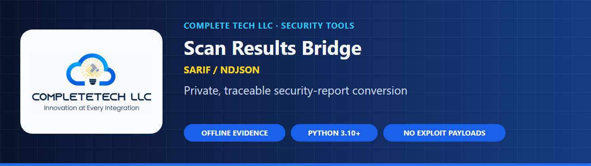
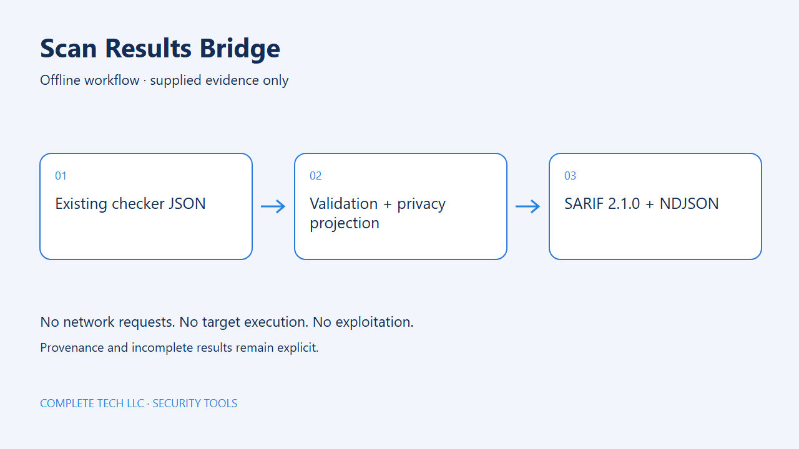

<p align="center">
  
</p>

<p align="center">
  <a href="https://github.com/CompleTetech-Security/scan-results-bridge/actions"></a>
  
  
  <a href="LICENSING.md"></a>
</p>

# scan-results-bridge

Optional offline report conversion for the CompleteTech security checker family.
Python 3.10+, one standalone file, standard library only. It converts existing
JSON reports into SARIF 2.1.0 or NDJSON. It never scans targets, executes code,
loads packages, reads credentials, or uploads data. Individual checkers do not
depend on this tool. Code: AGPL-3.0 or commercial; see LICENSING.md.

```sh
python scan_results_bridge.py --input examples/report.json --format sarif --output report.sarif
python scan_results_bridge.py --input examples/report.json --format ndjson --include-relative-paths
python scan_results_bridge.py --input node-report.json --input-schema node2shell-v1 --fail-on either
python -m unittest -v
python scan_results_bridge.py --help
```

The example is synthetic. Output defaults to stdout. Existing files require
`--force`; checker/input aliases and hardlinks remain protected. Rendering occurs
before an atomic file publication. Interruptions exit 130 without publication
retry; interrupted stdout or an interrupt at the commit boundary may leave an
incomplete/indeterminate publication. Keep unrelated reports out of commits.

## Offline workflow

<picture>
  <source media="(prefers-color-scheme: dark)" srcset="docs/images/overview-dark.png">
  
</picture>

Supplied local evidence only. The tool does not contact targets or execute the software being assessed.

## Accepted contracts

Select the schema explicitly; one profile applies to all inputs in an invocation.
Unsupported tools/versions and malformed or contradictory canonical evidence fail
closed with exit 2. The canonical validator is bundled from
[Sharp's common contract](https://github.com/CompleTetech-Security/sharp-rsvg-rce-check/blob/14955717ab29676828dc215e993d987c40e3f575/vendor/common.py)
under the same code license; no installed shared package is required.

| Profile | Input |
| --- | --- |
| `contract-v1.0` (default) | Complete schema 1.0 object with tool/rules/results, including semantic evidence-reference validation |
| `node2shell-v1` | Legacy unversioned node2shell-check tool_version 1.0.0 JSON; named adapter only, not a universal schema |
| `copyescape-v1.1` | copyescape-check schema_version `1.1` |
| `vm2-v1.1` | vm2-nesting-check report_schema_version `1.1` |
| `simplegit-v1.1` | simplegit-rce-check report_schema_version `1.1` |
| `atlassian-v1` | atlassian-cve-2026-21589-check integer schema_version 1 |
| `flowise-v1` | flowise-cve-2026-69254-check integer schema_version 1; version_status maps to normalized status |

Legacy adapters validate consumed envelope/status/exploitability/version fields;
they do not claim validation of every unused legacy report field. Threat metadata
is kept separate from local `exploitability: not_tested`. No input status becomes
confirmed exploitation, and fixed-version observations never become safety claims.
Confidence is retained when its vocabulary matches; otherwise it is `unknown`.
The original evidence receives a deterministic digest for local reconciliation.

## Privacy and evidence

Default exports use a structural privacy projection: asset labels, URLs, paths,
arbitrary object keys, evidence prose, versions, secrets and original remediation
text are replaced by SHA-256 identifiers. Known evidence kinds/states, confidence,
booleans/numbers and uncertainty survive. Exported remediation directs the reader
to the original private report and vendor guidance. This deliberately omits raw
prose rather than claiming a regex can remove every possible credential. Retain
the original report securely to interpret the projected evidence. Hashes are
linkable and dictionary-guessable; they are not anonymous identifiers. Public tool
and rule identifiers are retained as required by SARIF.

Relative source paths are also omitted unless `--include-relative-paths` is set.
That switch explicitly permits publishing those reported paths; review filenames
for secrets before enabling it. Only bounded relative paths and integer source
lines from source evidence qualify. Inventory paths, network URLs and missing
locations do not produce fabricated code locations. Absolute paths, drive/URL
schemes, backslashes, empty/traversal components and control characters are rejected
as locations. Valid Unicode paths are percent-encoded in SARIF URIs.

Fingerprints combine tool, rule, private asset identity, component instance and
reported source location; they exclude status, run time and input ordering.
This preserves identity across status changes at the same location. Moving a line
or changing an asset identifier changes its fingerprint; this is not semantic
code matching. Exact projected duplicates collapse; conflicting statuses or
evidence remain separate observations. Results and rules have deterministic
ordering, with no generated timestamp. All output is JSON escaped.

## Severity and CI policy

SARIF uses warning for potentially_affected/precondition_present/likely_exposed,
note for unknown, unsupported, fixed or mitigated observations. This is a triage
level, not a CVSS score or an exploitability claim. Original status/confidence and
complete state remain properties; incomplete SARIF invocations are unsuccessful.
NDJSON ends with an explicit summary record, including empty results.

Each validated input also contributes a report envelope independently of result
rows: SARIF stores these under each matching tool/version run's
`properties.input_reports`; the NDJSON summary stores them in `reports`.
Each envelope retains public tool/version and profile, explicit completion,
`report_sha256` for the full canonicalized input, `evidence_sha256` for its
report-level metadata, and a privacy-projected `evidence` object. Canonical rule
snapshots and limitations therefore survive empty runs. Input filenames are never
published. Envelopes are sorted deterministically; repeated identical inputs
remain repeated, and differing inputs remain attributable by digest. These are
content identities, not authenticity or deployed-patch attestations. Report
metadata uses the same structural privacy projection as observation evidence;
retain the original private report to interpret hashed prose and field names.

Exit 0 means complete conversion with selected policy satisfied. `--fail-on`
findings, unknown or either returns 1 **after** successful output. Unknown includes
unsupported_runtime and source_discrepancy. Default none does not fail on findings.
Operational/malformed/unsupported input or incomplete input returns 2. A policy
exit never suppresses results. No HEC/syslog transport or credential configuration
is implemented; conversion remains offline.

Bounds: 20 inputs, four MiB each, 16 MiB combined, depth 40/250,000 JSON nodes per
input, 16,384 characters per string, 10,000 combined results, 32 MiB output. A
single invocation uses one profile. No silent truncation. Local inputs and output
directories should be stable and controlled by the operator; this is not a
concurrent hostile-filesystem service.

## SARIF schema validation

The unmodified official OASIS schema is bundled under `schemas/` with its original
license terms. The checker CLI and normal tests need no third-party dependencies.
An optional development check uses jsonschema; CI runs it locally against the
bundled schema, including source, inventory-only, Unicode, findings, unknowns,
and empty/incomplete runs. No remote schema references are fetched by tests.

```sh
python -m pip install jsonschema==4.25.1
python tools/validate_sarif.py
```

Sources: [OASIS SARIF schema](https://github.com/oasis-tcs/sarif-spec/blob/main/sarif-2.1/schema/sarif-schema-2.1.0.json),
[GitHub SARIF support](https://docs.github.com/en/code-security/reference/code-scanning/sarif-files/sarif-support).
Schema validation is format verification; it does not prove GitHub ingestion or
live code-scanning display. No upload or production acceptance was performed.

Canonical version assessments are retained explicitly; full component metadata
and sources are privacy-projected and included in observation identity, so
conflicts do not deduplicate. Fingerprints use the stable component name, not its
version/build assessment. Each tool/version SARIF invocation has its own combined
completion state, including tools whose input reports have no result rows.
Non-finite numbers, including overflowing JSON exponents, fail before publication.

When reported, same-line source candidate ordinals and hashed input-artifact
identities disambiguate fingerprints without inventing source columns. Exact
duplicates retain an `occurrences` count; NDJSON summary includes observation_count.
The raw combined-result limit applies before deduplication. Canonical rule snapshot
metadata participates in projected evidence so different snapshots remain distinct
observations. Numeric observations, including reported line numbers in projected
evidence, remain visible; path publication still requires explicit opt-in.

Published tool versions must use the public numeric `major.minor.patch` format, including canonical reports and empty runs. Free-form version labels are rejected before output because they can contain private metadata. Canonical report limitations are included in the privately projected evidence digest. Corroborating source records at the same path and line retain one unambiguous location.
